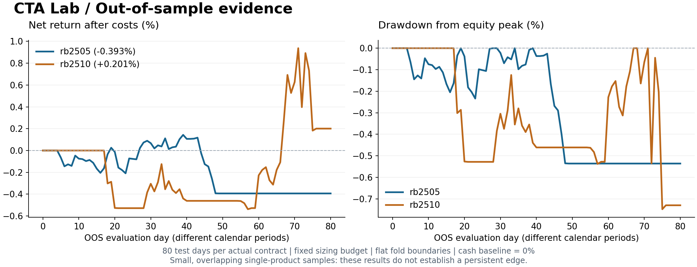

# vnpy-cta-lab

基于 **VeighNa / vn.py 4.5.0** 的国内期货 CTA 研究与历史订单回放项目。实现数据来源追踪、Donchian/ATR 策略、风险限额、逐日盯市、滚动样本外验证及离线报告。

项目使用官方 `CtaTemplate` 和 `BacktestingEngine`，不重新实现撮合。定位是可审计的研究工程作品：能够说明策略为什么下单、下一根 K 线如何成交、成本如何计算，以及全样本收益为何不等于样本外表现。

## 已运行的真实行情研究

数据来自上海期货交易所官方 2024、2025 年年度压缩包。研究对象预设为两个实际螺纹钢合约，分别运行，不拼接连续合约、不做换月收益假设。

| 合约 | 有效日线 | 数据区间 | 全样本净收益 | 样本外净收益 | 样本外 Sharpe | 样本外成交笔数 |
|---|---:|---|---:|---:|---:|---:|
| rb2505 | 234 | 2024-05-16 至 2025-04-30 | 0.6353% | -0.3933% | -1.5526 | 4 |
| rb2510 | 238 | 2024-10-16 至 2025-09-30 | 1.1802% | 0.2008% | 0.2737 | 6 |

样本外由 120 根初始训练、每折 40 根测试构成，每个合约产生两个完整测试折，合计 80 个测试交易日。剩余不足一折的尾部明确列为未评估。两个合约的日期存在重叠，不能视为独立市场证据，也没有把两个 100 万资金账户直接相加成一个组合收益。

**结论：目前不能支持“策略具有稳定超额收益”。** 一个合约样本外亏损，样本短、成交少；正收益不足以证明 alpha。详见 [研究报告](docs/RESEARCH.md) 和 [机器可读证据](docs/results/)。这是研究结论，而不是待调参消除的报错。



## 快速运行

建议使用 64 位 Python 3.11。vn.py 包含 Qt 等较大依赖，首次安装需要一定下载时间。

```powershell
python -m venv .venv
.venv\Scripts\Activate.ps1
python -m pip install -e ".[dev,data]"
python -m cta_lab.cli demo
```

Linux/macOS 将激活命令替换为 `source .venv/bin/activate`。如 PowerShell 禁止执行激活脚本，可直接使用 `.venv\Scripts\python.exe` 执行后续命令，无需改变系统策略。

`demo` 无需网络、数据库和交易账户，生成可复现的合成数据并运行完整研究链路。打开 `artifacts/demo/report.html`，页面含离线交互图表、成本敏感性和样本外指标。**合成数据仅用于工程演示，不能用来证明市场收益。**

真实数据研究一条命令：

```powershell
python scripts/run_research.py
```

脚本从官网索引解析下载链接，缓存压缩包，读取 XLS/XLSX、转换实际合约、校验输入并运行研究。已有缓存时复用；已完成转换时可加 `--skip-download`。数据下载发生网络错误时会失败，不会自动改用合成数据。

```powershell
python -m pytest -q
python -m ruff check .
python -m ruff format --check .
```

`requirements-lock.txt` 保存本次已验证的 Windows/Python 3.11 依赖快照，需要完全匹配时先 `python -m pip install -r requirements-lock.txt`，再安装本项目。CI 文件配置了 Windows/Linux 检查，但远端运行状态须以 GitHub Actions 实际结果为准。静态结果图可选安装 `.[viz]` 后运行 `python scripts/plot_results.py` 重新生成。

## 数据和输出

- `config/`：合约乘数、价格跳动、成本假设及策略/风险参数。
- `src/cta_lab/shfe.py`：上期所年度文件导入与来源清单。
- `src/cta_lab/strategy.py`：日线信号、仓位、收盘止损和风险退出。
- `src/cta_lab/runner.py`：实际 vn.py 引擎接入、异常与期末持仓检查。
- `src/cta_lab/research.py`：扩展训练窗口、固定参数网格、非重叠测试。
- `tests/`：独立交易现金流对账、已知成交案例、因果性、风控及回测失败处理。
- `docs/results/`：可公开核查的汇总统计、参数选择、数据哈希和版本。
- `artifacts/`：本地 HTML、逐日盈亏、成交明细和事件审计；Git 忽略。
- `data/downloads/`、`data/private/`：本地原始与转换行情；Git 忽略。

输入 CSV 必须精确包含 `datetime,open,high,low,close,volume`，日期为 `YYYY-MM-DD` 交易日。重复、乱序、非有限数、错误 OHLC、非正价格和负成交量会拒绝导入。脚本不补缺失交易日。

自有数据示例：

```powershell
python -m cta_lab.cli run --csv data/private/shfe/rb2505.csv --config config/rb2505.json --data-kind real --source "合法取得的实际合约日行情；具体来源、授权和处理规则" --walk-forward --train-bars 120 --test-bars 40 --out artifacts/rb2505
```

## 策略与执行约定

收盘突破**前 N 根**最高价时做多，跌破前 N 根最低价时做空。ATR 使用截至当前收盘已知的真实波幅均值。持仓以反向通道或 ATR 追踪阈值在**收盘**判断退出，不假装能在当日最低/最高点止损。

下单量为以下三者最小值并向下取整：初始资金风险预算 / ATR 止损损失、名义敞口限额 / 每手名义价值、最大手数。默认每笔风险预算 0.5%、名义敞口上限 50%、最多 5 手。止损距离是计划风险，跳空可能使实际损失更大。

委托是有限的积极限价单，买价为信号收盘价的 110%，卖价为 90%，经 vn.py 按 tick 取整。最早在下一根日线撮合；超出限价的跳空可能不成交。每日收盘撤销未成交委托，不把限价单称作市价单。信号时的仓位限额不保证跳空后的成交名义敞口仍低于限额。

默认当日盯市亏损达 2% 时发出平仓信号；权益较历史峰值回撤达 10% 后锁定停止开仓。它们在日线收盘检测、下一根尝试退出，不是盘中损失上限。研究窗倒数第二根收盘提交退出，最后一根用于撮合；若仍有持仓则整次运行失败。

手续费按每边成交额万分之一、滑点按每手每边 1 tick 扣除。这是统一研究假设，不宣称等于历史经纪商费率。权益按收盘标记，**不是交易所结算价保证金账单**。没有模拟保证金追缴、涨跌停排队或成交量容量。详见 [架构与计算约定](docs/ARCHITECTURE.md)。

## 回放与实际交易的边界

`events.json` 中保留信号、订单 ID、成交和风险事件；样本外每折的成交与事件在 `evidence.json` 中。它们提供历史纸面执行演示。项目未配置 CTP/SimNow、未运行真实柜台模拟账户，不承诺可以直接实盘启动。

## 求职材料

[面试与简历讲解](docs/INTERVIEW.md) 包含 90 秒介绍、关键代码入口、研究失效解释和一周演练安排。简历应强调实现与验证，不能把生成的合成业绩、样本内最优表现或未做过的实盘经历写作个人成绩。

## 来源和许可

代码采用 MIT 许可；第三方 vn.py / vnpy_ctastrategy 的许可见 [THIRD_PARTY_NOTICES.md](THIRD_PARTY_NOTICES.md)。原始行情权利属于提供者，项目代码许可不授予行情再分发权。公开仓库仅保存研究汇总与哈希。使用官网数据前应阅读其使用声明。

- [上海期货交易所](https://www.shfe.com.cn)：官网「数据 → 统计数据 → 数据下载」；产品栏可查螺纹钢合约参数。
- [VeighNa CTA 策略文档](https://www.vnpy.com/docs/cn/community/app/cta_strategy.html)
- [VeighNa CTA 回测文档](https://www.vnpy.com/docs/cn/community/app/cta_backtester.html)
- [官方回测引擎源码](https://github.com/vnpy/vnpy_ctastrategy/blob/main/vnpy_ctastrategy/backtesting.py)
