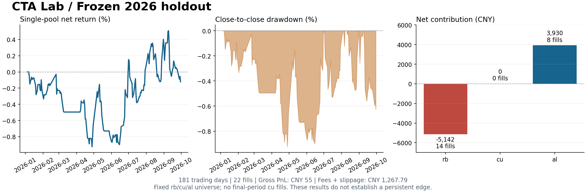

# vnpy-cta-lab

基于 **vn.py 4.5.0 / vnpy_portfoliostrategy 1.3.0** 的国内期货多品种 CTA 研究项目：实际合约因果换月、共享资金账户、参数封存与独立测试、逐日现金流对账。兼顾量化研究与量化开发求职展示。

## 实际完成的研究

事前固定螺纹钢、铜、铝三个品种，使用上期所实际月份合约 OHLCV 与持仓量。2023–2024 开发，2025 验证；六组统一参数选择完成并公开提交后，才下载和评估 2026 年 1–9 月数据。研究协议、实现、参数选择分别保留 Git 提交，代码与数据哈希可检查。

| 最终测试指标 | 结果 |
|---|---:|
| 初始共享权益 | 1,000,000 元 |
| 测试交易日 / 成交笔数（每边） | 181 / 22 |
| 期末权益 | 998,787.2145 元 |
| 净收益率 / Sharpe | **−0.1213% / −0.1003** |
| 最大回撤 | −0.9236% |
| 毛盈亏 / 手续费与滑点 | 55 / 1,267.7855 元 |

**这组结果不支持稳定盈利。** 保留测试亏损，不根据测试结果重选参数。铜在最终测试中没有成交，仍完整保留在固定品种池与贡献表中。20 次合约选择变更对应 7 笔实际换月相关成交，不能当作 20 次完成换月。



[完整研究报告](docs/PORTFOLIO_RESEARCH.md) · [架构与记账约定](docs/PORTFOLIO_ARCHITECTURE.md) · [固定协议](docs/PORTFOLIO_PROTOCOL.md) · [参数选择锁](research/portfolio_selection.json) · [公开结果与测试凭据](docs/results/portfolio_holdout.summary.json)

这是历史研究操作顺序审计，不是 2026 年之前预注册的预测。测试已经被使用，再运行属于复现。

## 快速运行

建议 64 位 Python 3.11，首次安装 vn.py 的 Qt 等依赖需要一定时间。

```powershell
python -m venv .venv
.venv/Scripts/Activate.ps1
python -m pip install -e ".[dev,data]"
python -m cta_lab.portfolio_research demo
```

Linux/macOS 使用 `source .venv/bin/activate`。PowerShell 不能激活时，直接用 `.venv/Scripts/python.exe` 执行命令即可。

离线演示使用明确标注的合成实际月份合约，无需数据账户或网络。打开 `artifacts/portfolio/demo/report.html`，查看共享权益、名义敞口、预计保证金、各品种贡献、信号及成交事件。合成收益不作为市场证据。

复现已经发表的真实研究：

```powershell
python scripts/reproduce_portfolio.py
```

脚本使用已发表的上期所归档 URL 和 SHA-256，下载并清洗原始数据，验证冻结代码、协议及参数，重放最终测试并逐项比较统计；**不搜索参数，不覆盖原始公开首次测试凭据**。首次运行需要网络，原始文件较大。若来源文件变化，校验失败，不用替代数据凑出结果。报告位于 `artifacts/portfolio/reproduction/report.html`。

仓库包含本次研究的参数锁。`select` 是新研究的封存流程，不是本次结果的复现步骤；已有锁或已访问最终测试数据时拒绝重新选择。修改冻结研究代码后也不能冒用原始凭据继续运行。新研究应建立独立协议、路径和未用于选择的证据。

```powershell
python -m pytest -q
python -m ruff check .
python -m ruff format --check .
```

本地已通过 41 个测试；Windows/Linux GitHub Actions 状态以仓库 Checks 为准。`requirements-lock.txt` 是本次 Windows/Python 3.11 环境快照。可选安装 `.[viz]`，再运行 `python scripts/plot_portfolio.py` 更新静态结果图（需要先完成真实研究复现）。

## 核心实现

- **因果换月**：D 日收盘后用当日及更早的持仓量、成交量与交割缓冲规则选择合约，最早 D+1 开盘执行。只向后续交割月换仓，各实际合约维护自己的指标，不把换月价差记成利润。
- **共享资金**：一个 100 万账户，逐笔平仓后释放预算，再按固定品种顺序尝试开仓。使用实际开盘价检查单品种风险、合计初始止损风险、名义敞口和预计保证金，预算不足拒单。
- **真实引擎接入**：使用官方 StrategyTemplate、BacktestingEngine 撮合与日盈亏计算，在边界处过滤缺失行情和不可执行订单；独立现金流账本逐日与官方组合盈亏对账。
- **封存和失败处理**：记录实现/协议/参数/行情哈希，禁止测试期重选；持仓行情缺失或回调未完成即失败，不能返回看似有效的部分回测。

测试覆盖已知成交、换月跳价、双边成本、跳空超预算、旧仓未平、资金释放、缺失行情、未来价格与持仓量扰动，以及选择和最终测试访问门槛。真实最终样本没有触发预算拒单，拒单行为通过合成用例验证。

| 路径 | 内容 |
|---|---|
| src/cta_lab/portfolio_model.py | 合约选择、指标窗口与共享账户 |
| src/cta_lab/portfolio.py | 官方组合引擎、策略和执行约束 |
| src/cta_lab/portfolio_data.py | 上期所实际合约 OHLCV/OI 面板与来源校验 |
| src/cta_lab/portfolio_research.py | 开发、验证、封存、最终测试与复现入口 |
| src/cta_lab/portfolio_report.py | 离线交互报告与审计文件 |
| tests/ | 金融行为、时序、数据和封存测试 |

原始 ZIP、转换面板在 data/downloads/、data/private/；本地逐日账本、成交及 HTML 在 artifacts/。这些目录由 Git 忽略，公开仓库只保留代码、汇总与来源哈希。日线标签按交易日处理，未还原夜盘分钟时序或历史数据发布时间。

## 模型边界

使用前序 Donchian 通道与 ATR；收盘形成信号，下一开盘撮合。止损、日亏损退出、回撤停开仓均在收盘检测，不能保证盘中损失上限。旧仓平掉后才能开新仓；新合约指标不足或不足一手时允许仅退出旧仓。

每边手续费为成交额万分之一、滑点 1 tick，预计保证金统一按 15% 估算。它们是研究假设。权益按收盘盯市，不是交易所结算价保证金账单；没有模拟逐日历史保证金、容量、涨跌停排队、盘中追保或交易柜台。项目尚未接入 CTP/SimNow，也没有实盘收益或生产运行声明。

## 求职与早期版本

[面试与简历材料](docs/INTERVIEW.md) 提供 90 秒介绍、答辩问题、五分钟演示和一周安排。请在亲自复现并掌握代码后使用，简历只写自己能讲清并现场演示的内容。

保留的 v1 是两个实际螺纹钢合约各自运行的单合约基线，不属于当前共享资金组合。[v1 研究](docs/RESEARCH.md)、[v1 架构](docs/ARCHITECTURE.md)、`python -m cta_lab.cli demo` 和 `python scripts/run_research.py` 均指这个早期实验；不能把两份账户收益相加冒充组合。

## 来源与许可

代码采用 MIT；[第三方许可](THIRD_PARTY_NOTICES.md) 包括 vn.py 及策略应用。行情权利属于提供者，代码许可不授予行情再分发权。

- [上海期货交易所数据下载](https://www.shfe.com.cn/reports/tradedata/datadownload/)
- [VeighNa 组合策略文档](https://www.vnpy.com/docs/cn/community/app/portfolio_strategy.html)
- [官方组合回测引擎](https://github.com/vnpy/vnpy_portfoliostrategy/blob/main/vnpy_portfoliostrategy/backtesting.py)
