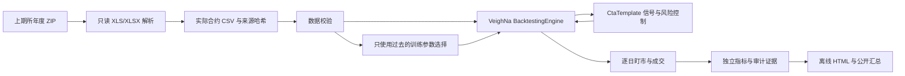

# 架构与计算约定

## 数据流

框架负责撮合与每日盈亏；本项目负责输入约束、策略、参数选择、风险预算、结果度量和可复核输出。`VerifiedBacktestingEngine` 仅增加完整处理 K 线计数，不修改上游撮合或盈亏逻辑；这是因为上游循环可能捕获策略异常并提前返回，直接调用结束不等于成功回放。

## 日期与合约

CSV 日期表示交易所给出的交易日，使用无时区的日粒度标签；不把夜盘自然日与交易日混用。只支持每日数据，不宣称能够处理分钟级夜盘归属。周末、节假日和缺失数据不会自动补齐，滚动窗口按实际输入根数计数。

上期所工作簿读取中文列名，兼容“日期/交易日期”；对合并单元格形式的合约名向下填充。英文副表头、小计和非合约记录不进入数据集。实际合约按标识匹配，剔除交割月及无有效 OHLCV 的记录，并记录每条剔除原因。价格边界与非有限数由独立 CSV 校验再次检查。

不创建主连或回溯主力。两个交割月份分别回测。若要实现换月，必须再设计只使用当时已知持仓量/成交量的选择规则、可交易合约上的平旧开新、双边成本及期限结构影响；不能拼接价格后直接撮合。

## 信号和订单生命周期

1. 当前日线先由 vn.py 对之前的活动委托撮合。
2. 更新成交、持仓、手续费、滑点和内部风险现金账。
3. `on_bar` 只看截至当前收盘已知的信息。通道取前 N 根；当前价格不能参与构造被其突破的通道。
4. 收盘撤销剩余限价，提交新的有限限价，下一根才有机会成交。
5. 信号、订单 ID、成交、持仓及风险事件写入审计列表。

开仓后不加仓，不在同一个信号内从多头直接反手为空头；先退出，后续日线再判断新入场。收盘跟踪止损不是盘中止损撮合。有限限价可能不成交，退出失败不会被强制改写成虚拟成交。

## 风险账与仓位

设初始资金为 C，风险比例 r，ATR 距离为 D，每手乘数为 M，价格为 P，名义敞口比例为 e，最大手数为 K：

`quantity = max(0, min(floor(C*r/(D*M)), floor(C*e/(P*M)), K))`

预算小于一手时不取整成一手。固定初始资金用于每折仓位预算，不进行收益再投资。信号时的止损损失预算不构成最大实际损失保证，跳空、成本和限价不成交都能扩大损失。

内部现金账在每笔成交更新：`cash -= signed_quantity * fill_price * M + costs`，权益为 `cash + position * close * M`。日收益相对上个输入交易日权益计算；峰值包含初始资金。2% 日亏损触发退出；10% 回撤锁定停开仓直到下一次独立研究运行，退出仍需下一根撮合。研究模式无重启持仓恢复，也未接入经纪商账户、保证金及委托频率监管。

## 成本、权益和指标

- 手续费：`price * volume * multiplier * commission_rate`，每笔成交各收一次。
- 滑点扣款：`volume * multiplier * tick * slippage_ticks`，独立从 PnL 扣除，不二次改写成交价。
- 每日权益：`initial_capital + cumulative_net_pnl`。
- 简单日收益：`equity_t / equity_(t-1) - 1`，首日以前的权益是初始资金。
- Sharpe：零无风险利率，日收益均值 / 样本标准差 × sqrt(240)；没有波动或破产时留空。
- CAGR：`(ending/initial) ** (240/evaluation_days) - 1`，不把它称为真实长期预测。
- 回撤：权益 / 包含初始资金的历史峰值 − 1，因此首日亏损也会计入。

这里独立计算的复合年化和简单收益 Sharpe 与 vn.py 自带统计口径可能不同；不能将两组指标混称为同一种计算。

独立测试在**期末持仓为零**的条件下，将成交现金流、双边手续费、滑点重新求和，与 vn.py 逐日盈亏汇总对账。同时提供固定四根 K 线案例验证成交发生在下一日开盘及亏损数值。

## 样本外协议

初始训练窗 120 根、后续每次增加 40 根，紧接着测试 40 根；参数网格仅包含 entry_window={20,40,60}、atr_multiple={2,3}。其他配置从研究配置继承，训练 Sharpe 最大者入选，少于 4 笔成交视为不可评分，全部不可评分时使用预先声明的首个参数而不是读取测试结果。该阈值仅防止无交易评分，不提供统计显著性。

测试前最多传入 61 根历史 K 线用于指标预热，`trade_start` 前不能下单。每折先以空仓开始，最后一根前发退出，包含退出成本；这种边界处理不是无缝连续交易。测试折无重复日期，权益汇总采用初始资金加非重叠测试 PnL。每折的仓位预算仍为固定初始资金，并非按汇总权益复投。

训练、测试边界和参数选择均输出。测试后的尾部不足一折就不评价。修改测试行情不得改变该折的训练评分，这是回归测试的一部分。没有另留完全未触碰的最终 holdout，当前结果应视为研究评估，而不是可反复调参后仍声称独立的最终检验。

## 可复现与限制

归档 ZIP 与 CSV 具有 SHA-256；证据包含实际 Python 与关键依赖版本。Python 随机数仅用于固定种子的合成夹具。`requirements-lock.txt` 记录已运行的 Windows/Python 3.11 环境；其他系统通过项目依赖安装并由 CI 配置覆盖，不能将未实际执行的远端 CI 说成已经通过。

公开仓库只发布代码、配置和派生汇总，原始行情、逐笔价格、账户文件和 Token 不入库。历史回放不等于 CTP/SimNow 联调；研究结果不支持实盘部署。将来如扩展模拟柜台，必须实现拒单、撤单确认、部分成交、断线重连、合约状态和持仓恢复，并单独进行事件驱动测试。
