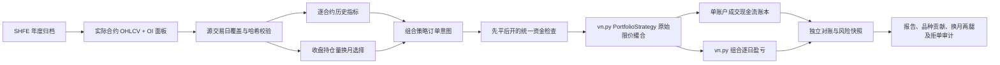

# 组合版架构：因果换月、统一权益与独立测试

## 组件与边界

`portfolio_model.py` 实现合约选择、逐合约指标及共享权益账本；`portfolio.py` 连接官方 `StrategyTemplate` / `BacktestingEngine`；`portfolio_data.py` 维护原始合约面板；`portfolio_research.py` 隔离参数选择和最终测试；`portfolio_report.py` 生成离线报告，不参与参数选择或撮合。

官方引擎仍负责生成成交及逐日盈亏。本项目在进入原始撮合前逐笔检查订单，没有用三份单合约资金曲线拼成“组合”。

## 时间与数据

日期是交易日标签，日线开盘是该日线的起始价格，不代表午夜或日盘 09:00；本项目不声称完成分钟级夜盘时钟重建。采用日终持仓量在下一根交易日日线开盘前可获得的研究假设，未重建历史发布时延。

面板保留实际合约、开高低收、成交量和持仓量，不生成复权主连。中文表头与合并单元格被规范化，非法 OHLCV/OI 有逐条剔除日志。零成交量且有效报价的记录可用于估值，但不具备合约选择资格；无效价格不能被伪造成可交易报价。

日历来自官方月报中所有品种实际出现的日期，三个固定研究品种必须覆盖这些来源交易日。它能识别子集中的缺日，不能证明官方源文件本身没有整日遗漏，不等同于独立的交易所节假日日历。

## 换月决定和执行

在 D 日收盘比较各实际合约 D 日持仓量、成交量及已知交割月份。交易量至少 100、持仓量为正，且交割月第一日距决策日大于 20 个自然日。先比较持仓量，再比较成交量，再按较早交割月份和合约名打破平局。

已有合约保持资格时，只有后续月份持仓量达到原合约 1.10 倍才切换；不倒退到较早月份。原合约不合格时向更后月份迁移。审计记录选择时间、下一开盘生效标记、所选持仓量/成交量和原合约持仓量，可对照本地面板验证。

各合约有自己的未复权价格窗口。突破通道排除当前日线；ATR 可使用截至当前收盘已知的真实波幅。换月保留持仓方向，但按新合约 ATR 和共享权益重新确定手数；旧合约已触发退出时不移仓重开。

平旧与开新是两笔独立委托，分别付手续费和滑点。引擎先处理全部平仓，再按固定 rb、cu、al 顺序处理开仓。旧合约未实际平掉，新合约不能开仓；不会把两个合约的价格差作为持仓收益。

## 开盘撮合的约束

官方组合引擎会对缺失数据使用缓存价格构造 K 线；本项目在撮合前排除没有当日实际 K 线的订单。如果已有持仓缺失当日行情，整次回测失败，不能沿用昨日价格隐藏风险。

只接受下一根日线开盘已经满足限价的委托，随后交由上游撮合，因此成交在该开盘价发生。若开盘不满足限价，即使当日最高/最低价后来触及，也撤销而不成交。这避免用完整日线的盘中路径决定开盘资金分配，但也不模拟真正的盘中限价策略。

收盘信号限价为买入 110%、卖出 90%，按合约 tick 取整；不是交易所涨跌停价，也不是保证成交的市价单。没有还原涨跌停排队、部分成交、容量和真实柜台拒单。

## 统一权益账本与资金检查

账本只创建一次初始资本 C。每笔成交的符号数量为 q、价格为 P、乘数为 M：

`cash_ledger -= q * P * M + commission + slippage`

任一时点以同一组可知报价标记：

`equity = cash_ledger + sum(position_i * mark_i * multiplier_i)`

这是交易现金流与标记价值的会计恒等式；`cash_ledger` 不是期货经纪商可用现金。预计保证金为各持仓绝对名义价值乘统一研究保证金率，预计可用资金为 `equity - estimated_margin`。权益按收盘标记，不按交易所结算价制作保证金账单。

每笔开仓在**实际开盘价格和此前已成交的全组合持仓**上检查，并扣除本笔预估成本后再比较：

- 单品种初始止损风险 ≤ 权益 0.5%，组合初始风险合计 ≤ 1.5%。风险距离使用该次开仓的初始 ATR 距离，不把它称为实际最大损失保证。
- 单品种名义敞口 ≤ 50%，组合名义敞口 ≤ 150%。
- 预计保证金 ≤ 权益 35%，统一保证金率 15% 为研究假设。
- 每合约最多 10 手，一个品种只持有一个实际月份。

候选手数按收盘权益、ATR 和单品种名义限额向下取整；开盘跳空后重新检查，预算不满足时整笔拒绝，不偷偷缩放或假设成交。每笔成交更新同一账本后，下一笔才能检查。这样即使多个信号同时发出，也不会各自重复使用同一份资金。固定先后顺序带来分配偏好，已事先公开，不能据测试收益调整。

## 风控和终止

日收盘损失达 2% 时发退出，历史权益回撤达 10% 时停止新增仓位；组合总名义或预计保证金超限也尝试退出。已有持仓可能因跳空超限，阈值不保证盘中损失上界。权益负值时允许减仓退出，不能以账户破产为由拒绝平仓。

评估区间倒数第二根提交退出，最后一根撮合；仍有持仓或活动订单则失败。逐日完整处理计数用于识别上游捕获异常后的部分运行，任何中断不能被报告为完整结果。

## 对账与测试

每日 `cash_ledger + marked_positions` 必须与 `initial_capital + cumulative_vnpy_net_pnl` 一致。品种和实际合约贡献来自同一上游组合账单，汇总后必须与组合收益一致。

合成用例验证：旧合约恒为 100、新合约恒为 200，换月不带来毛利润；正常两腿费用都必须计入。其他用例覆盖共享预算耗尽、跳空后的预算重审、先平仓释放资金、旧腿失败阻断新腿、缺失行情、禁止盘中触价冒充开盘成交，以及改变未来价格/OI不影响较早事件。

## 冻结与最终测试

开发/验证/测试区间必须依次排列且不重叠。选择阶段拒绝任何超过验证终点的面板；最终行情下载需要有效参数锁。锁包含协议、7 个研究源文件、开发面板哈希、全部 6 组评分、选择结果和源提交。

最终测试入口先验证锁与开发数据哈希，再读取测试数据，只使用已选参数，不运行优化。测试面板来源清单绑定同一锁哈希；使用记录保存首次评估时间、配置身份和结果。同一身份可重复核对，变更身份不能静默重跑。它是研究操作审计，不是不可绕过的安全沙箱，也不能证明分析者没有通过其他渠道接触公开市场信息。
